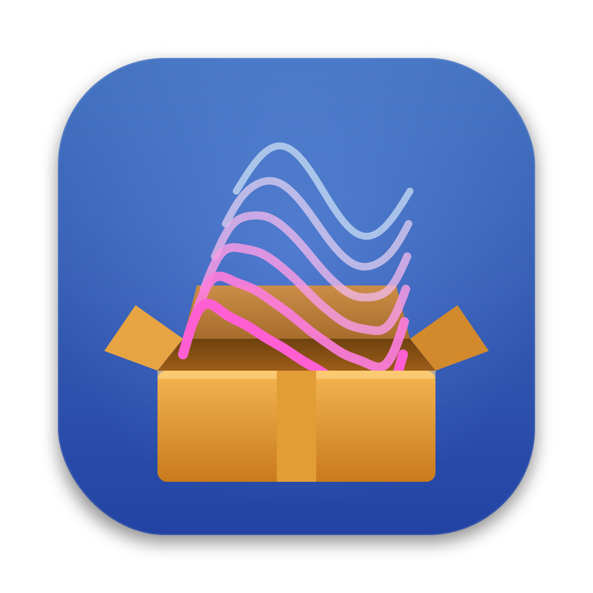
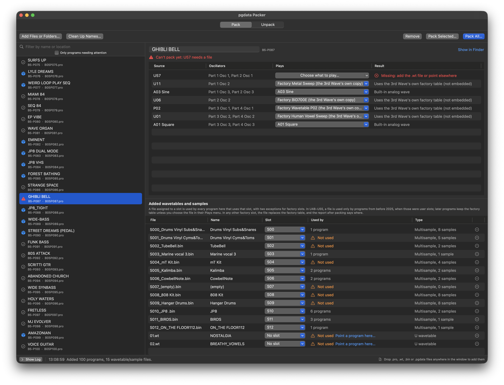
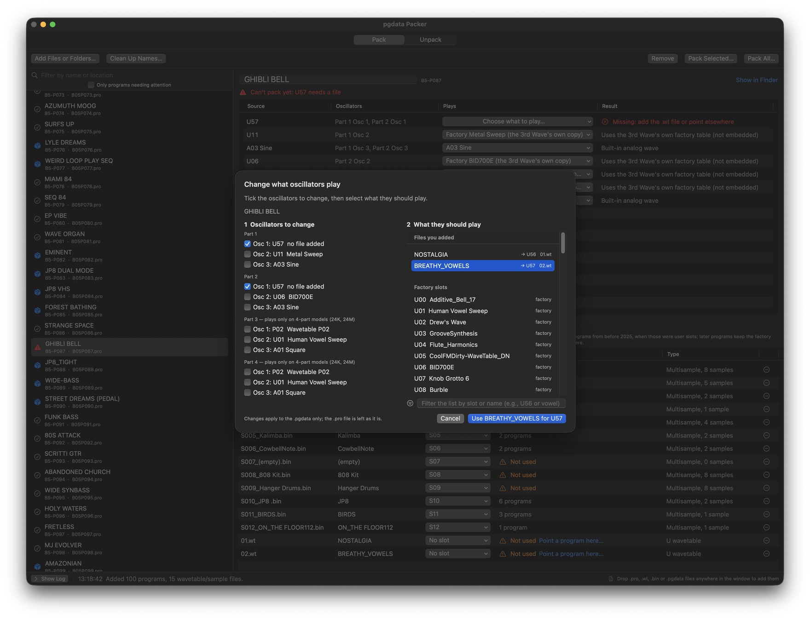
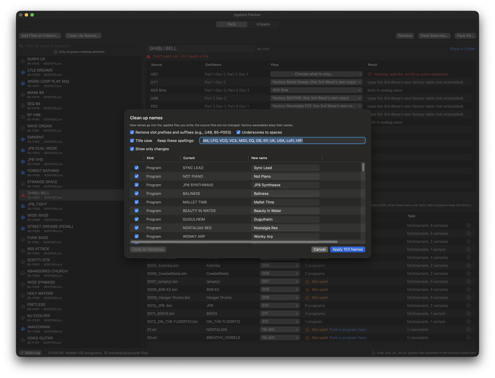
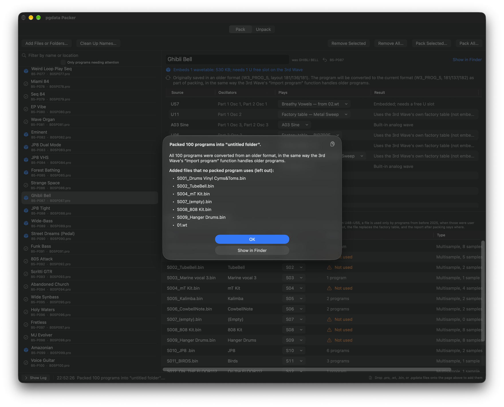
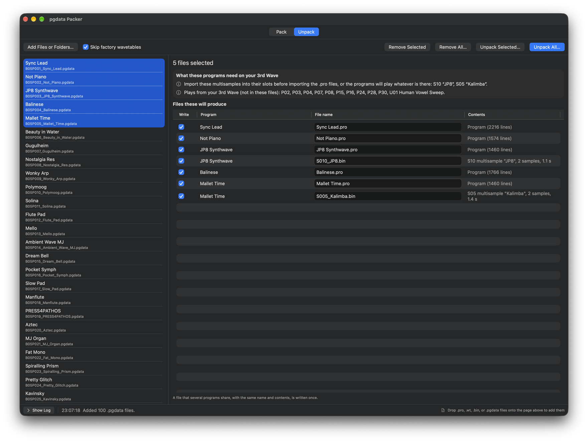

# pgdata Packer

*for the Groove Synthesis 3rd Wave*

A macOS app that packs Groove Synthesis 3rd Wave programs (`.pro`) together with the wavetables
(`.wt`) and multisamples (`.bin`) they use into unified program files (`.pgdata`), and unpacks
`.pgdata` files back into those parts.

Not affiliated with or endorsed by Groove Synthesis. Everything here was worked out from files and
checked on an 8M and a 24M, both running OS 2.0d. The Formats and Tests sections say what was
confirmed on the 3rd Wave and what is inferred.

**Building something for the 3rd Wave?** The file formats are (unofficially) documented, and the library
behind this app, test files, and a developer tool are free to use under the MIT licence: see
[For developers](#for-developers).



## Download

Download `pgdata-Packer-<version>.zip` from the
[latest release](https://github.com/adambier/3rd-wave-tools/releases/latest), unzip it, and move
the app wherever you like, for example to your Applications folder. The app is signed with a
Developer ID and notarized by Apple, so it opens like any other app, on Apple Silicon and Intel
Macs. Requires macOS 13 or later.

From 1.0.4, the app updates itself, using [Sparkle](https://sparkle-project.org): on its second
launch it asks whether to check automatically, and **Check for Updates…** in the app menu checks
at any time. In the Help menu, **Read Me** opens this page and **File Format Reference** the format
reference; **Release Notes** opens the notes for the version you have.

## Build

Or build it yourself; it takes a minute. Requires macOS 13 or later and the Xcode command-line
tools (`xcode-select --install`; Xcode 14.1 or later, for the macOS 13 SDK). There is no Xcode
project.

```
git clone https://github.com/adambier/3rd-wave-tools.git
cd 3rd-wave-tools
./make-app.sh          # builds "pgdata Packer.app" in this folder
open "pgdata Packer.app"
```

The first build downloads Sparkle from GitHub (checked against its SHA-256 and kept in `build/`),
so it needs a network connection; later builds work offline. An app built on your own Mac is
signed only for that Mac (an "ad-hoc" signature); it opens normally there, and macOS warns about
it elsewhere.

The tests (`./run-tests.sh`) need a full Xcode installation (15 or later) on a Mac; on Linux and
Windows, `swift test` runs them directly. (On a Mac, `Package.swift` includes the test target only
when `PGDATA_TESTS=1` is set, which the script does, so that a plain `swift build` works with the
command-line tools alone. Such a build has no Sparkle, so no **Check for Updates…**.)

## Using it

The window has two pages, **Pack** and **Unpack**. There is nothing to set up. Every report or
list of problems the app shows has a copy icon beside its title that puts the text on the clipboard.

### Factory wavetables

The app never embeds factory wavetables. A program that uses a factory slot (U00–U55, P00–P35)
lists the slot without data, and the 3rd Wave that loads the file plays its own factory table, unless
you add a different table for that slot (see Pack).

The app knows each factory table by name and by a fingerprint of its content (built in from Groove
Synthesis's factory `.wt` files; only names and fingerprints are stored). It uses them to:

- show factory slot names (e.g., "U00 Additive_Bell_17");
- treat an added file that is identical to the factory table of its slot as that table (listed,
  not embedded), for example a table unpacked from the 3rd Wave's own export, which carries every
  table a program uses;
- leave factory tables out of the free-slot estimate, since a 3rd Wave that has them reuses them;
- skip, when unpacking, tables identical to the factory table in their slot, and never offer
  factory tables for renaming.

**U48–U55.** These joined the factory set in 2025, alongside OS 1.9 (which also brought `.pgdata`).
The 8M ships with them. 24K and 24M owners download them from Groove Synthesis's support site
(after logging in) and load them with Global → **Bulk wavetable import**. The app assumes the 3rd
Wave that loads a `.pgdata` has them.

Before 2025 those were user slots, and some older program sets used them for their own tables,
shipped as `.wt` files named with the slot (e.g., `U48 Warm Pad.wt`). So in a program saved before
OS 1.9, U48–U55 are treated like user slots: missing until you add the table, which is then
embedded and goes into a free slot on import. A note with the program explains this and the three
ways to fix it: add the author's table, point the oscillators elsewhere, or choose the factory
table anyway from the Plays menu.

A program counts as saved before OS 1.9 when its format is older than `W3_PROG_5` or its float
block has fewer than 544 values. Every program saved since OS 1.9 that has been seen has 544 or
more (544 from OS 1.9, as in Groove Synthesis's factory banks from August 2025; 548 from OS 2.0);
every older set has fewer. The file carries no date, so this is an inference from the layout.

A table from a user slot (U56–U63, P36–P47) or a multisample that a program uses is always
embedded from a file you add, because whoever loads the file will not have the same user slots or
sample memory.

### Pack

Drop `.pro` files, plus the `.wt` and `.bin` files they use (folders work too). For each program
the app lists its oscillator sources and what each will be:

- **a file you added and assigned to that slot,** since it is what the program's author supplied.
  A file named with its slot (e.g., `U48 Warm Pad.wt`, `S010_Strings.bin`) is assigned to it
  automatically; assign others in the Slot column. One assignment serves every loaded program that
  uses the slot, with two safeguards for factory slots: a file in U48–U55 is used only by programs
  saved before OS 1.9 (later programs keep the factory table, and can still choose the file in the
  Plays menu), and a file in any other factory slot is used but flagged, in the program's status and
  in the report after packing, as replacing the factory table;
- **for a factory slot: the factory table,** listed but not embedded. An added file identical to it
  is listed the same way;
- **for a user slot or a multisample with no file added: missing.** The program is not written
  until you add the file or, for a wavetable, point the oscillators elsewhere.

You can change any choice from the Plays menu.

A line under the program name sums it up: what will be embedded, the size of the `.pgdata`, and
how many free slots the 3rd Wave will need; or what the program still needs before it can be packed.
The list on the left can be filtered by name or location, or limited to programs needing
attention.

A program in a layout not seen before (a format other than `W3_PROG_3` to `_5`, or an unusual
number of values per part) gets a warning: the app finds the oscillator sources from the layout, so
check them, and check the program on the 3rd Wave after importing. A source number outside every
known range shows as an unknown source, and the program is not written until those oscillators are
pointed elsewhere. Content that does not look like the 3rd Wave's own is flagged too: a wavetable
whose samples go beyond ±1, or a multisample whose samples are out of key order or carry values
outside the ranges Groove Synthesis specifies. A file that cannot be read at all (empty, cut
short, or not the kind its extension says) is reported once, with the reason, and left out.

**Programs in an older format are converted as they are packed.** A program saved by older
firmware (`W3_PROG_3`, `W3_PROG_4`, or a `W3_PROG_5` from before OS 2.0) is brought up to the
current format in the same way the 3rd Wave's **Import program** function converts it, and a line
under the program name says so. This matters because **Import unified program data file** does
only part of that conversion, and a 2022 factory program packed unconverted plays silently. The
converter was checked against 599 conversions made by an 8M and a 24M and matches the 3rd Wave's
own result value for value, except for eight 2022 factory programs that the 3rd Wave corrects
individually on import, by name (see [`docs/FORMATS.md`](docs/FORMATS.md#6-converting-older-programs)).
The packed program keeps all four parts, so one file works on every model: an 8M fits it to its
two parts when it imports it.

#### Changing what oscillators play

**Play something else…** in the Plays menu (or **Choose what to play…**, the first choice when a
wavetable is missing) opens a sheet. Tick the oscillators to change, then pick what they should
play:

- a file you added (listed first). When the program needs a slot that has nothing yet (e.g., U57),
  the sheet preselects an added file that has no slot yet and assigns it to that slot, so the
  oscillators stay as they are;
- any factory U or P slot (searchable by slot or name);
- an analog wave (A00–A06).

The Source column then shows, for example, **U01 → U56**, with a button to undo. Only the
`.pgdata` changes; the `.pro` is not modified. Multisample oscillators are not repointed.



Parts 3 and 4 play only on the 4-part models (24K, 24M). In every program saved on an 8M seen so
far, they hold filler (P02, U01, and an analog wave).

Added files that no program uses are flagged in the files table ("Not used", or "Not used: the
slot plays something else" when the slot is filled some other way; the tooltip gives the reason). **Point a program
here…** opens the same sheet for the file. Unused files are listed again after packing.

#### Names

The program name at the top of the detail area can be edited. **Clean Up Names…** proposes tidier
names for the programs and for the wavetables and multisamples you added (never factory
wavetables):

- slot numbers removed from the start or end (e.g., "U48 Warm Pad" → "Warm Pad", "S010_Strings_"
  → "Strings", "B5-P003 Name" → "Name");
- underscores to spaces;
- title case for names written entirely in capitals or entirely in lower case (e.g., "GLASS
  BELLS" → "Glass Bells"). Names that already mix cases keep their capitals.

Within title case:

- words with digits stay as they are (e.g., JP8, TB303);
- words with no vowels count as acronyms (e.g., PWM, PPG, FM); Y counts as a vowel, so "SYNTH"
  becomes "Synth";
- words on an editable list keep a fixed spelling (e.g., LFO, MIDI, LoFi);
- short joining words are lower case except at the start (e.g., "DRUMS AND AMPS" → "Drums and
  Amps"), and the parts of a hyphenated word are cased separately (e.g., "LO-FI PAD" → "Lo-Fi
  Pad").

Every proposal is shown, can be edited, and can be unticked. New names go into the `.pgdata` and
its file name. Source files are not changed, and unpacking keeps names as they are.



Name fields hold 31 characters, and the 3rd Wave displays all 31 for programs, wavetables, and
multisamples. A longer name is flagged next to the name, in the program's notes, and in the report
after packing, and is cut to 31. The fields hold single-byte characters only, so a name with an
en dash, curly quotes, or an emoji is flagged as well: those characters are written as "?".

#### Writing

Every program gets a `.pgdata`, even one that uses only factory tables and analog waves. A
`.pgdata` that embeds nothing is usually smaller than its `.pro` (about 10–30% for the factory
programs, since six-decimal floats become 4-byte words), though a program with a long sequencer
section can come out a little larger. Each embedded U table adds about 0.5 MB, each P table about
65 KB, and a multisample its audio.

**Pack Selected…** and **Pack All…** (⌘⇧S) ask for a folder. If some programs can't be packed yet,
the app asks first whether to pack the others. Existing files are never replaced without asking,
and the report at the end can open the folder in the Finder.



Files are named in Groove Synthesis's own pattern, with the program location first:
`B05P87_Glass_Bells.pgdata`, as in Groove Synthesis's `B05P06_Glass_Cow_Bell_Transients.pgdata`.

- The location comes from the `.pro` file name (e.g., `B05P100.pro`), since a `.pro` does not
  record it. Groove Synthesis's older layout of a `Bank 1` folder holding `001.PRO` to `100.PRO`
  is read too.
- The prefix keeps the 3rd Wave's alphabetical bulk import in program order.
- As in the 3rd Wave's own exports, spaces become underscores and everything other than ASCII letters,
  digits, hyphens, and underscores is dropped (e.g., "Big Bass (MW)" → `Big_Bass_MW`). This affects
  the file name only, not the program name inside it.
- A batch that includes a program 100 uses three digits throughout (e.g., `B05P087_…`,
  `B05P100_…`). The 3rd Wave itself writes `B05P09_…` and `B05P100_…`, but its bulk import takes
  files in plain character order, where `B05P100` sorts between `B05P10` and `B05P11` (checked on a
  24M), which would put it out of order.
- If any program being written has no location in its file name (for example, a renamed file, or a
  `.pro` written by Unpack), all of them are numbered by their place in the batch instead (e.g.,
  `001_…`, `002_…`).

### Unpack

Drop `.pgdata` files. Each becomes a `.pro` named after the program, a `.wt` per embedded
wavetable named with its slot (e.g., `U57_Warm Pad.wt`), and a `.bin` per multisample named as
Groove Synthesis's sample library names them (e.g., `S010_Strings.bin`).

When a batch writes any wavetables or multisamples, the files go into the folders your 3rd Wave's
USB drive uses: `PROGRAMS` for `.pro`, `WAVES` for `.wt`, and `AUDIO` for `.bin`, so you can copy
them onto the drive as they are. A batch of programs alone is written straight into the folder
you choose.

A box above the file list says what the program needs on your 3rd Wave: which multisamples go
into which S slots before you import the `.pro`, and which slots the program plays from your 3rd
Wave rather than from the file. It appears only when there is something to say. Select several
files to see everything they will produce in one list, with the program each file comes from.



Untick anything you don't want, or rename it, before **Unpack Selected…** or **Unpack All…**.
Wavetables identical to the factory table in their slot are skipped by default (**Skip factory
wavetables**): the 3rd Wave's own
export embeds factory tables too, and a repack lists them anyway. Unpacked names are kept as they
are.

A `.pgdata` does not record the program's format. One that holds a program in an older layout
(built by another tool; the 3rd Wave's own exports are always current) is converted as it is
unpacked, in the same way as in Pack, and the box says so. The app works out the old format from
the layout, so the unpacked `.pro` is always in the current format, `W3_PROG_5`.

## On the 3rd Wave

Checked on an 8M (OS 2.0d), and most points on a 24M as well
([`docs/FORMATS.md`](docs/FORMATS.md#7-what-the-3rd-wave-does-on-import) says which). What the
3rd Wave does when it imports a file:

- **A table or multisample the 3rd Wave already has** (same content, in any slot, whatever its
  name) is reused. No slot is used, and the 3rd Wave keeps its own name for it.
- **A new table or multisample** goes into a free slot, and the program is pointed there. The slot
  number in the file is only a label. With no free slot, the 3rd Wave offers to overwrite its last
  ones; blank placeholder tables count as used. The Pack page shows how many free wavetable slots a
  program may need; each embedded multisample the 3rd Wave does not already have also takes a free
  S slot. (For multisamples, the 3rd Wave's message says it erases the most recently loaded
  samples; not tried here.)
- **A table or multisample listed without its data** plays whatever is in that slot on the 3rd Wave,
  with no warning; an empty sample slot plays silence. That is why multisamples are always
  embedded.
- **Programs in an older format** are converted on import: fully by **Import program** and **Bulk
  program import**, only in part by **Import unified program data file**. That is why this app converts them before
  packing (see Pack). Details are in
  [`docs/FORMATS.md`](docs/FORMATS.md#6-converting-older-programs).

> [!WARNING]
> **Unplug the USB cable from your computer while the 3rd Wave exports.** With the drive mounted on
> a computer at the same time, exports have been observed to write empty files. Plug it back in when the export has
> finished.
>
> **Empty the `PROGRAMS` folder before exporting.** An export onto an existing file of the same name
> does not shorten it, so a longer old file leaves its tail behind the new program. (The app
> recognises such a file by its header, drops the leftover values when packing or unpacking it,
> and says so.)
>
> **Leave only one `.pgdata` in `PROGRAMS` when using Import unified program data file.** It takes
> the first file in alphabetical order without asking.

## For developers

pgdata Packer is one tool; a major aim of this project is to help make it easier to build others,
in any language. Everything here is open source under the MIT licence.

- **The format reference.** [`docs/FORMATS.md`](docs/FORMATS.md) describes the structure of the
  3rd Wave's four file formats, for someone implementing them for the first time, and how the 3rd
  Wave behaves when it imports them. It is enough to read, write, pack, unpack, convert, and rename
  programs, wavetables, and multisamples. **What most of a program's values mean is not yet
  known:** fewer than 60 of a program's roughly 1,450 values have an identified meaning, so it does
  not yet support tools that create sounds or edit a program's settings. Footnotes give the evidence for each statement (a test on a 3rd Wave, or
  Groove Synthesis's own documents), and what is still unknown is listed at the end.
- **Test files.** [`fixtures/`](fixtures/) holds a small file of each kind, each with a JSON file
  of what it should parse to, so a new reader or writer can be checked without a 3rd Wave at hand.
  They are synthetic, so they can be used freely.
- **A Swift library.** `PgdataFormats` reads and writes every format byte for byte, packs and
  unpacks `.pgdata` files, converts older programs as the 3rd Wave does, and recognises Groove
  Synthesis's factory wavetables. It depends only on Foundation, and its tests run on macOS, Linux,
  and Windows. Add it to a Swift package with
  `.package(url: "https://github.com/adambier/3rd-wave-tools", from: "1.0.5")` and the product
  `PgdataFormats`. Its documentation, with a getting-started guide, is at
  [adambier.github.io/3rd-wave-tools](https://adambier.github.io/3rd-wave-tools/documentation/pgdataformats/).
  The library is versioned with the app (tags `v1.0.5` and on).
- **The app's logic, for other platforms.** `PgdataPackerCore`, the package's second library,
  holds pgdata Packer's own decisions without its user interface: pack and unpack plans, factory
  table handling, file names, and Clean Up Names. A command-line tool, or an app for Windows or
  Linux, can use it to behave exactly like pgdata Packer. Its API may change between versions more
  than `PgdataFormats`'s.
- **A command-line tool.** `tw3pg` (in `Sources/tw3pg`) inspects files, checks that they round
  trip, unpacks and repacks `.pgdata` files, and converts older programs:
  `swift run tw3pg inspect <file>`.
- **Contributions.** Corrections to the format reference are the most valuable contribution,
  whether from tests on a 3rd Wave or from knowing better; so are bug reports with the files that
  show them, and word of tools built on this. [`CONTRIBUTING.md`](CONTRIBUTING.md) explains how.

## Formats

[`docs/FORMATS.md`](docs/FORMATS.md) is the full reference: what is known about `.pro`, `.pgdata`,
`.wt`, and `.bin` files and the oscillator source ids, how the 3rd Wave converts older programs, and
what is still open. Footnotes give the evidence for each statement, and inferences are said to
be inferences. In brief:

- **.pro**: text, one value per line: the format tag (`W3_PROG_3` to `_5`), the name, four sizes
  (integers and floats per part, global values, sequence events), then four integer part blocks
  (each starting with its three oscillator source ids), four float part blocks, the globals, and the
  sequence events.
- **.pgdata**: `W3_UNIPROG_1`, a table of the sources the program uses (each with its embedded `.wt`
  values or multisample, or listed without data), then the program name and the `.pro` values as
  32-bit words. It has no format tag.
- **.wt**: text: `PNAME` or `UNAME`, the name, then one float per line.
- **.bin**: `W3_MSAMPLE_<v>`, a slot name and up to eight samples with their settings and 16-bit
  audio.
- **Source ids**: each oscillator stores what it plays as one number. The ranges are irregular, and
  the seven analog waves are not numbered in the order the 3rd Wave lists them.

## Verification

Run against about 2,700 real files: Groove Synthesis's factory banks (8M, and 24-voice versions 1
and 2b), sample library, and OS 1.8 example files, plus nine third-party program sets. These checks
use the `tw3pg` developer tool, which keeps each table as it was; the app's own repack lists
factory tables instead of embedding them, so its output differs there by design.

- Every `.pro`, `.wt`, `.pgdata`, and v5 `.bin` reads and rewrites byte for byte (v1 and v4 `.bin`
  files are upgraded to v5).
- All 221 `.pgdata` files unpack and repack identically, up to the `.pro` format's six-decimal
  float precision (the 3rd Wave's own `.pro` export has the same limit).
- All 325 embedded wavetables compared are bit-identical to the `.wt` files they came from.
- Packing Groove Synthesis's factory `.pro` files reproduces the structure of their `.pgdata` (19
  for the 8M, 19 for the 24-voice models): the same sources, in the same order, with the same
  samples. What differs: Groove Synthesis's files embed the factory tables and this app lists them
  without data; a few values that appear to be state captured at export time (one per part); and
  the leftover source references from unused parts, which this app lists and Groove Synthesis's 8M
  exporter does not (their 24-voice files do). One 24-voice program's `.pro` and `.pgdata` differ
  in real settings; they appear to be different editions.

## Tests on the 3rd Wave

Besides the import behaviour above, name lengths and the 3rd Wave's own export file names were
checked on the 3rd Wave. The conversion of older programs was worked out from 599 programs
bulk-imported and exported again on an 8M and a 24M, and programs converted and packed by this
app were imported on both. The 3rd Wave's exports were also
unpacked and repacked byte for byte with `tw3pg`. The test `.pgdata` files are built with `tw3pg`
from files that are not included here (a Groove Synthesis factory program and one of its `.wt`
files, two third-party programs, and a small `.bin`).

Still unknown: how the 3rd Wave writes non-ASCII letters in file names; whether a 24K converts
older programs exactly as the 24M does; and the meaning of most program values.

## Layout

```
Sources/PgdataFormats/      the library (the package's PgdataFormats product): formats, packing,
                            conversion; no UI; Foundation only (tested on Linux and macOS)
  SourceRef.swift             source-id mapping
  ProgramFile.swift           .pro
  WavetableFile.swift         .wt
  Multisample.swift           .bin and the shared sample record
  UnifiedProgram.swift        .pgdata
  PackUnpack.swift            Packer / Unpacker
  ProgramConverter.swift      older programs to the current layout, as Import program converts them
  FactoryLibrary.swift        factory wavetables by slot, name, and fingerprint
  FactoryCatalog.swift        factory table names and fingerprints (generated)
  ByteIO.swift                byte reading and writing, 32-byte name fields
  PgdataFormats.docc/         the library's documentation pages
Sources/PgdataPackerCore/   the app's own decision logic, no UI (the package's PgdataPackerCore
                            product): pack and unpack plans, output file names, Clean Up Names
Sources/PgdataPacker/       the app (SwiftUI)
Sources/tw3pg/              developer tool: inspect, roundtrip, unpack, repack, compare, wtcheck,
                            factory-catalog, pack, convert, convertcheck, and the 3rd Wave-test builders
Tests/PgdataFormatsTests/   unit tests (./run-tests.sh)
fixtures/                   test files with what each parses to, for other implementers
Resources/                  app icon, drawn by tools/make-icon.py (needs cairosvg and Pillow)
docs/                       FORMATS.md (format reference) and the screenshots used in this README
make-app.sh                 builds, signs, and notarizes the app; embeds Sparkle; writes the appcast
.github/workflows/          tests on Linux, macOS, and Windows; publishes the library's documentation
```

## License

MIT; see `LICENSE`. "3rd Wave" and "Groove Synthesis" are used only to say what this works with;
this project is not affiliated with or endorsed by Groove Synthesis.
